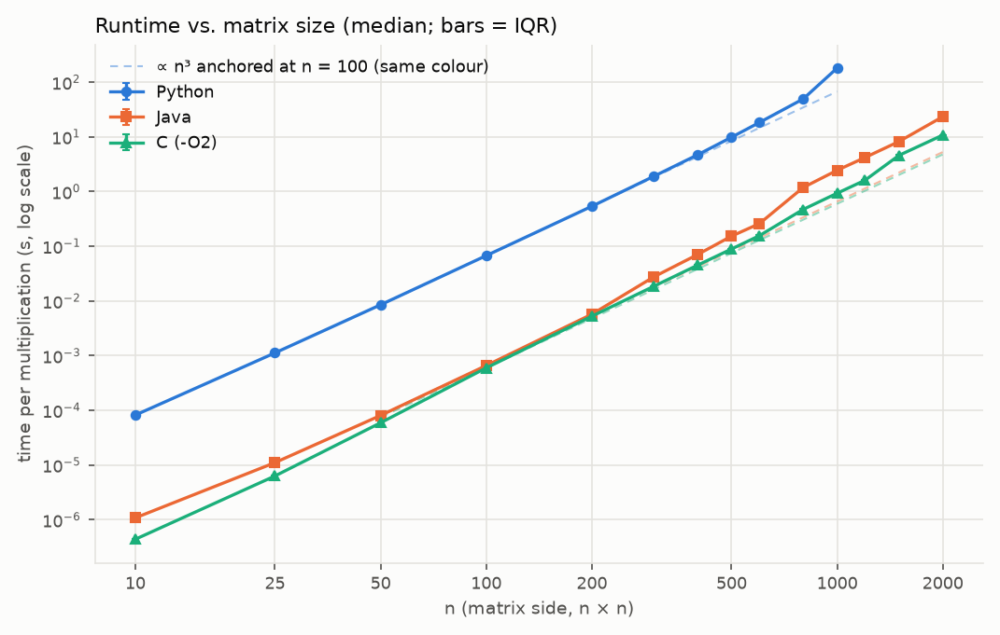
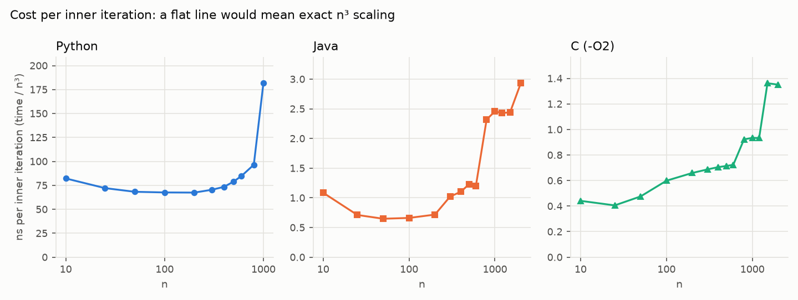
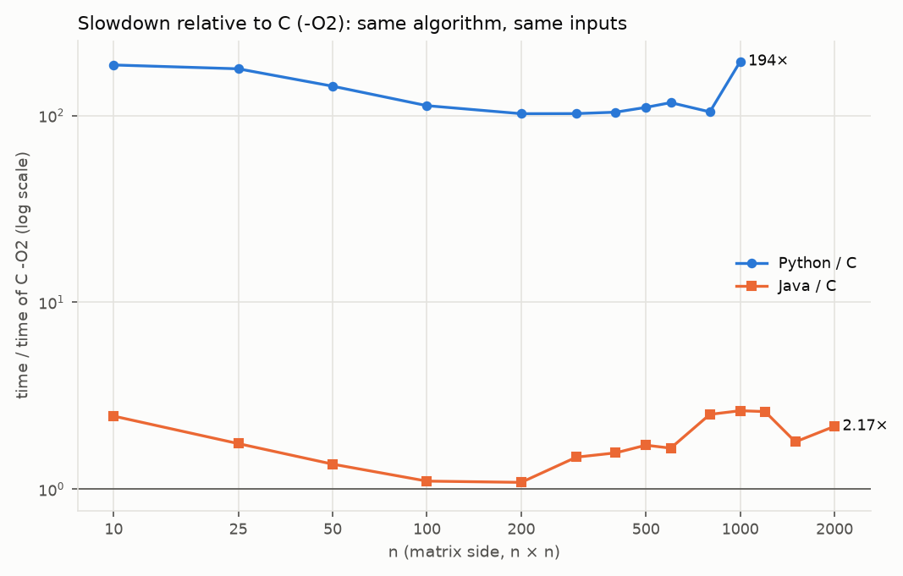
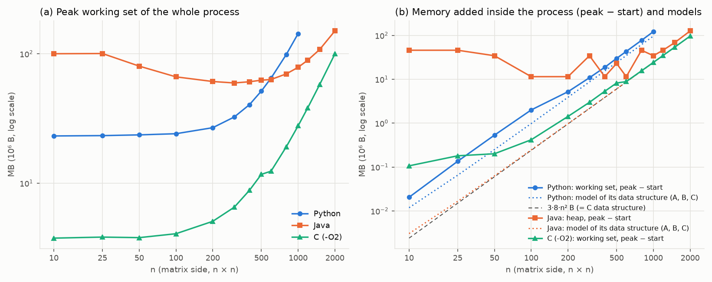
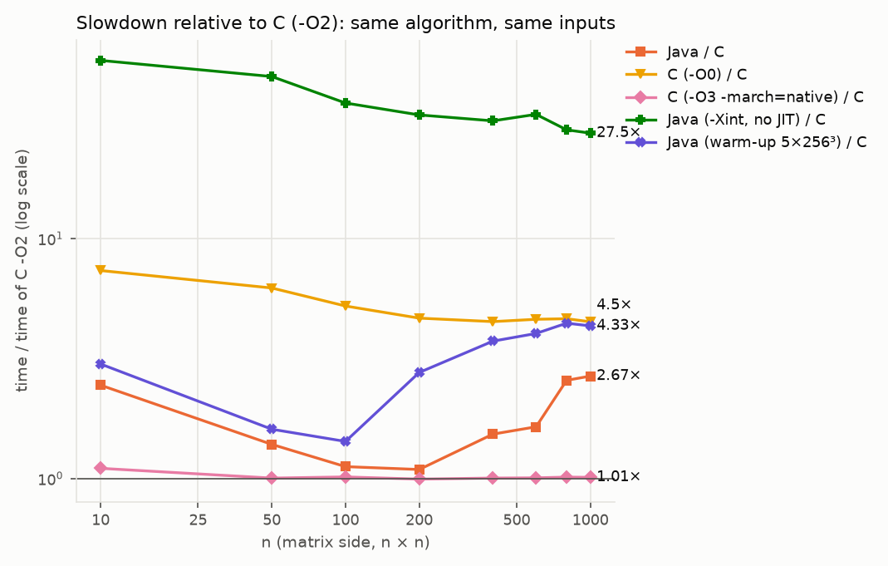
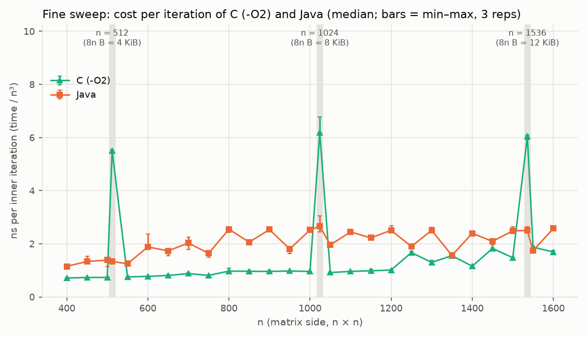
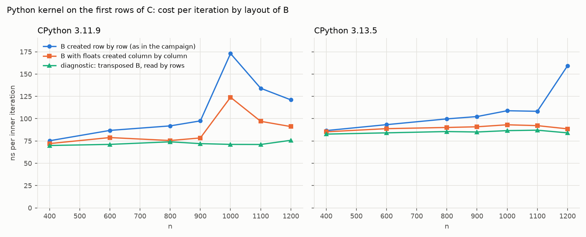

# How does matrix size affect the runtime and memory of naive matrix multiplication in Python, Java and C?

<div class="meta" markdown="1">
**Big Data · Individual Assignment 1 — Basic matrix multiplication in different languages**<br>
Grado en Ciencia e Ingeniería de Datos, Universidad de Las Palmas de Gran Canaria, 2026-2027<br>
**Author:** Guillermo Oltra Rodriguez · **Date:** October 2026<br>
**Materials:** repository folder `practica1/` (code, inputs, raw measurements, analysis scripts; see `README.md` and §8)
</div>

> **Abstract.** We compare the straightforward `i-j-k` triple-loop multiplication of dense `n × n`
> `float64` matrices, implemented the same way in Python 3.11, Java 17 and C (gcc 11, `-O2`), on the
> same inputs and the same machine (AMD Ryzen 7 4800H, Windows 11). Fourteen sizes from 10 to 2000
> were measured with a fresh process per measurement, the three languages interleaved and five
> repetitions. All three programs produce **bit-identical results**. Python is about **100 times**
> slower than C (102–117× for 100 ≤ n ≤ 800) because of interpreter overhead. With a properly
> warmed-up JIT, Java matches C while the data fit in cache (1.1×) and is 1.5–2.7× slower for large
> n. Runtime grows roughly as n³, but with log-log slopes of 3.2–3.6, because of steps in the memory
> hierarchy: the column-wise access to `B` stops fitting in the L3 cache and, when n is a power of two,
> causes cache-set conflicts that make C 6–7× slower — at n = 1024 Java beats C. Memory consists of a
> fixed runtime cost (C ≈ 4 MB, Python ≈ 23 MB, JVM ≈ 60 MB) plus a part proportional to n² that is five
> times larger in Python. Within a 300 s budget Python reaches n = 1000 and Java and C reach n = 2000.
> Three separate experiments (compiler and JVM flags, a fine sweep of n, and the memory layout of the
> Python data) explain these effects. Conclusions are limited to the tested implementations, settings,
> inputs and hardware.

## 1. Introduction and objective

Matrix multiplication is the core of much of numerical computing and machine learning, and the
straightforward triple loop is the baseline against which every later optimisation in this course
(blocking, sparse formats, parallel and distributed execution) will be judged. Before optimising, it
is worth knowing how much of the cost of the baseline comes from the algorithm itself and how much
from the language runtime and the memory system. This first study establishes that baseline for
three languages with very different execution models: an interpreter (CPython), a just-in-time
compiler (the HotSpot JVM) and an ahead-of-time compiler (gcc).

**Research question.** How do the runtime and the memory use of the naive triple-loop multiplication
grow with the matrix size `n` when it is implemented in the same way in Python, Java and C, on one
machine and with documented settings? To what extent does that growth follow the algorithmic model
`O(n³)`?

- **Factors varied:** the size `n` (14 values from 10 to 2000) and the implementation (Python, Java, C).
- **Outcomes measured:** time per multiplication (median and IQR of 5 repetitions) and the peak memory
  of the process (plus two in-process metrics, §3.7).
- **Held fixed:** the algorithm and loop order (`i-j-k`), the numeric type (`float64`), the input
  files, the machine, the measurement session and the timer boundary.

**Hypotheses** (written before the main campaign; the starting figures come from the pilot Python
campaign, `results/01_oficial_py311`, and from a smoke test with `n ≤ 300`):

- **H1 — cubic growth.** For `n ≥ 100` runtime will grow roughly as `n³` (log-log slope ≈ 3) in all
  three languages. In C and Java the slope is expected to be somewhat above 3 once matrix `B`
  (8n² bytes) no longer fits in cache, because the `i-j-k` order walks `B` by columns with a stride of
  8n bytes.
- **H2 — interpreter cost.** Python will be about 100 times slower than C, because every inner
  iteration executes several bytecode instructions and manipulates `float` objects (≈ 70 ns per
  iteration in the pilot campaign, versus ≈ 1 ns expected in C).
- **H3 — JIT.** After warm-up, Java will be within the same order of magnitude as C (factor 1–3),
  due to array bounds checks and the double indirection of `double[][]`.
- **H4 — memory.** For small `n` a fixed runtime cost will dominate (C: a few MB; Python: ~20 MB; JVM:
  tens of MB). The part that grows with `n²` will be ≈ 3·8n² B in C and Java and ≈ 3·32n² B in Python
  (a 24 B `float` object plus an 8 B pointer per element).

## 2. Background

**Algorithm and cost model.** For `C = A·B` with `n × n` matrices, the textbook algorithm computes
`C[i][j] = Σₖ A[i][k]·B[k][j]` with three nested loops: `n³` multiply-add operations and `n²` outputs
[1]. Its arithmetic work is exactly cubic, so if every inner iteration cost the same, runtime would
be `t(n) = c·n³` and a log-log plot of time against `n` would have slope 3. Any deviation therefore
comes from the cost per iteration `c` changing with `n`.

**Memory hierarchy and loop order.** Modern processors hide memory latency with a hierarchy of caches
and translation look-aside buffers (TLBs) [2], [3]. In the `i-j-k` order the innermost loop reads a
row of `A` sequentially but walks a *column* of `B` (`B[0][j], B[1][j], …`), so consecutive accesses
are `8n` bytes apart, each in a different cache line. Once the lines of a column no longer stay in
cache between consecutive `j`, the cost per iteration rises. Lam et al. showed that the performance
of matrix kernels depends strongly on the matrix size relative to the cache parameters and that some
sizes cause *self-interference* (cache-set conflicts) [4]; strides that are multiples of a power of
two are the classic pathological case [3]. On the Zen 2 core used here, L1d is 32 KiB 8-way, L2 is
512 KiB 8-way, L3 is 4 MiB per 4-core complex (CCX) and the second-level data TLB holds 2048 entries
[5].

**Execution models.** CPython executes bytecode in an interpreter; since 3.11 it specialises
instructions to the operand types it observes (PEP 659) [6], but every element is still a boxed
`float` object handled through reference counting. HotSpot first interprets Java bytecode, profiles
it and then compiles hot methods with the optimising C2 compiler; compiled code relies on
speculative assumptions taken from the profile, and when an assumption fails the code is discarded
("deoptimised") [7]. Since Java 17 all floating-point arithmetic is strict IEEE 754 [8]. gcc compiles C
ahead of time; with `-ffp-contract=off` it does not fuse a multiply and an add into a single FMA
instruction, which would change rounding [9].

**Benchmarking methodology.** Managed runtimes are non-deterministic from run to run, so results must
come from repeated measurements across fresh processes, summarised with robust statistics, and
warm-up must be handled explicitly [10], [11]. Seemingly irrelevant details of the setup, such as
memory layout, can bias measurements [12]; we interleave the languages and report variability for
this reason.

**Floating-point summation.** Summing `n` products in floating point accumulates a relative error of
at most about `n·u` (`u = 2⁻⁵³` for `float64`) and typically much less [13]; a different summation
order (as in a BLAS library) gives slightly different results. To compare whole matrices we use an
exactly-rounded sum of all elements (Shewchuk's algorithm, as in Python's `math.fsum`) [14], [15].

## 3. Methodology

### 3.1 Implementations

The three implementations execute the same statement in the same loop order. None uses a matrix
multiplication library; NumPy is used only outside the timer, to verify results.

```python
# Python (src/python/matmul.py)
def matmul_ijk(A, B, n):
    C = [[0.0] * n for _ in range(n)]
    for i in range(n):
        for j in range(n):
            for k in range(n):
                C[i][j] += A[i][k] * B[k][j]
    return C
```

```java
// Java (src/java/MatMul.java)
static double[][] matmulIjk(double[][] A, double[][] B, int n) {
    double[][] C = new double[n][n];            // the JVM initialises it to 0.0
    for (int i = 0; i < n; i++)
        for (int j = 0; j < n; j++)
            for (int k = 0; k < n; k++)
                C[i][j] += A[i][k] * B[k][j];
    return C;
}
```

```c
/* C (src/c/matmul.c): one contiguous row-major block viewed as a 2-D array (pointer to VLA, C99) */
__attribute__((noinline)) static double *matmul_ijk(const double *a_, const double *b_, int n) {
    double *c_ = malloc(sizeof(double) * (size_t)n * (size_t)n);
    const double (*A)[n] = (const double (*)[n])a_;
    const double (*B)[n] = (const double (*)[n])b_;
    double (*C)[n] = (double (*)[n])c_;
    for (int i = 0; i < n; i++) for (int j = 0; j < n; j++) C[i][j] = 0.0;
    for (int i = 0; i < n; i++)
        for (int j = 0; j < n; j++)
            for (int k = 0; k < n; k++)
                C[i][j] += A[i][k] * B[k][j];
    return c_;
}
```

Each language uses its idiomatic data structure. This is an unavoidable difference, documented here
and part of what is compared:

| Language | Data structure | Storage per matrix | Execution |
|:---|:---|:---|:---|
| Python | list of lists of `float` objects | ≈ 32 n² B (24 B object + 8 B pointer) | CPython 3.11.9, specialising adaptive interpreter |
| Java | `double[][]`: array of references to independent `double[]` rows | ≈ 8 n² B + 16 B per row + 4 B per reference | Temurin 17.0.20.1, tiered C1/C2 JIT |
| C | a single contiguous row-major block of `n²` doubles | exactly 8 n² B | gcc 11.2.0 `-std=c11 -O2 -ffp-contract=off` |

With `-ffp-contract=off` the C code rounds exactly like Python and Java, so the three implementations
perform *exactly* the same arithmetic (verified in §4.1). The C kernel is `noinline` so that it is a
real function call, as in the other two languages.

### 3.2 Inputs

The three programs read **the same binary files** `data/A_n.bin` and `data/B_n.bin` (`float64`
little-endian, row-major, no header), generated once by `src/python/datagen.py`. Values are uniform
in [0, 1) (CPython's Mersenne Twister). The base seed is 2026; the seed of `A_n` is
`2026·1000003 + 2n` and that of `B_n` is that plus one. The SHA-256 of every file is stored in
`data/manifest.json` and checked before every campaign. This avoids depending on the different
random generators of each language.

### 3.3 Environment

| Item | Value |
|:---|:---|
| Machine | Laptop, AMD Ryzen 7 4800H (Zen 2), 8 physical / 16 logical cores, 2.9 GHz base (boost up to 4.2 GHz) |
| Caches [5] | L1d 32 KiB and L2 512 KiB per core; L3 2 × 4 MiB (4 MiB per 4-core CCX) |
| Memory | 15.4 GiB |
| Operating system | Windows 11 Home 26H2 (build 26300) |
| Power | Plugged in (95 % battery), default power plan |
| Python | CPython 3.11.9 (MSC v.1938, 64-bit), no options; garbage collector disabled inside the timed region |
| Java | OpenJDK 17.0.20.1 (Temurin), `-XX:+UseSerialGC -Xms2g -Xmx2g`, default JIT |
| C | gcc 11.2.0 (MinGW-w64, `x86_64-w64-mingw32`), `-std=c11 -O2 -ffp-contract=off` |
| Threads | One compute thread in all three. `OMP/OPENBLAS/MKL_NUM_THREADS=1` in the child processes |
| Auxiliary libraries | NumPy 2.4.6 (verification and analysis only), matplotlib 3.11.2, psutil 7.2.2 |

All of the above is recorded automatically in `results/*/environment.md` and in
`build/build_info.json`. The JVM settings were chosen for reproducible behaviour: one GC thread and a
fixed 2 GB heap, with which no garbage collection happens inside the timed region
(`gc_count_timed = 0` in every row). Everything else was left at its default value. The OS-level
thread count of each process was sampled during the runs: 2 for C, 4–6 for Python and 19–22 for the
JVM (JIT compiler, GC and VM threads), although the computation itself is single-threaded.

### 3.4 What the timer includes

We measure **only the kernel**: the call that allocates `C`, initialises it to 0.0 and runs the three
loops. Allocation and initialisation of `C` are **inside** the timer in all three languages; interpreter
or JVM start-up, file reading, warm-up, checksum and dumping `C` are **outside**. Timers are monotonic:
`time.perf_counter_ns()`, `System.nanoTime()` and `QueryPerformanceCounter`. The result is always
consumed by a checksum of all elements (and, in C and Java batches, by a `volatile` variable) so the
compiler cannot remove the computation.

### 3.5 Measurement protocol

- **A fresh process per repetition** and language, so every sample starts from the same runtime state
  and has its own memory peak.
- **Interleaved order.** For each `n` and repetition the three languages run one after another, and
  the order rotates in each repetition, so a slow drift of the machine (temperature, background tasks)
  does not systematically favour any language.
- **5 repetitions** per configuration. If the first one exceeds 120 s, only 3 are taken because of
  cost; this happened only for Python at `n = 1000`.
- **Very short tasks.** If one multiplication takes less than 100 ms, a batch of `b` multiplications is
  timed in a single region and `time/b` is recorded. The batch size is calibrated with a previous,
  discarded run.
- **Warm-up** (never part of the sample). Python and C: one run on the 64×64 corner, enough for
  CPython 3.11's bytecode specialisation [6]. Java: 200 runs on 64×64 matrices (see §3.6).
- **Statistics.** Median and inter-quartile range (Q1–Q3, linear interpolation). All raw measurements
  are kept (`raw.csv`, one row per process) and none was excluded.

### 3.6 Java warm-up: a JIT effect found while validating the protocol

The first version warmed Java up with 5 runs of 256×256. At `n = 1000` the times were **bimodal**:
≈ 4.0 s in 5 of 6 runs and ≈ 2.4 s in the other. `-XX:+PrintCompilation` and `-XX:+LogCompilation`
revealed the cause: C2 compiled `matmulIjk` *during the first long call*, when the profile had never
seen the outer loop exit. In the next call that "impossible" branch was taken, an *uncommon trap*
fired (`reason='unstable_if'`, bytecode 13: the `i < n` test), the C2 code was discarded (*made not
entrant*) [7] and the measurement ran with less optimised code. Warming up with **many short calls**
(200 × 64³ ≈ 52 M iterations, about 60 ms) gives a complete profile: 0 deoptimisations in 5 of 5 runs
and a stable ≈ 2.4 s. Campaign `05` measures both variants to quantify the effect (§4.6).

### 3.7 Memory: three different quantities

1. **Peak working set of the whole process** (`proc_peak_wset_bytes`), read by the runner with the
   Windows API `GetProcessMemoryInfo` on the child process when it ends. Tool and definition are the
   same for the three languages, so **this is the metric compared across languages**. It includes the
   interpreter, the JVM or the C runtime.
2. **In-process measurement right after the multiplication** (`inproc_*`). In Python and C it is the
   peak working set (the same OS counter); its difference from the value before loading the data
   isolates what A, B and C add. In Java it is the **peak used heap** (`MemoryPoolMXBean`), a different
   quantity: it excludes the JVM itself and includes not-yet-collected garbage.
3. **Storage models** (estimates, not measurements): 3·8n² B for three dense matrices, and the size of
   the actual Python (`sys.getsizeof`) and Java (array headers) structures.

These quantities are never compared with one another as if they were the same.

### 3.8 Correctness

**36 automated tests** (`tests/`) run before every campaign. They cover known answers (1×1, 2×2 and
3×3 computed by hand, identity on both sides, zero matrix), non-commutativity (which detects swapped
indices), small integers (exact result), comparison with NumPy, binary I/O, the deterministic
generator, batching, input errors and the runner's memory measurement. The C and Java workers are
tested as black boxes in all six configurations (including those of §4.6).

During the campaign, on repetition 1 of each (language, `n`) the worker dumps `C` *after* timing and a
separate process compares it with NumPy's `A @ B` using `rtol = 1e-9` and `atol = 1e-12`. The error
bound `n·u` is ≈ 2·10⁻¹³ for `n = 2000` [13], and BLAS sums in a different order, so differences of
that order are expected; the tolerance leaves four orders of magnitude of margin and still detects any
indexing error, which gives relative errors of order 1. The SHA-256 of the dump is stored to check
whether the three languages produce **the same bits**. On repetitions 2–5 the checksum (exactly-rounded
sum, the `math.fsum` algorithm [14], [15] ported to C and Java) must match that of repetition 1.

### 3.9 Sizes and budgets (declared before measuring)

- **Size sequence:** 10, 25, 50, 100, 200, 300, 400, 500, 600, 800, 1000, 1200, 1500, 2000.
- **Time budget:** 300 s wall-clock per process, including start-up and data loading.
- **Memory budget:** 4096 MB per process, checked against the measured peak.
- **Stopping rule:** a timeout, out-of-memory or error is recorded as a **result** with no invented
  time, and that language does not try larger sizes; the others continue.

## 4. Results

The data are in `results/04_comparativa_3_lenguajes/`: `raw.csv` (194 processes, one per row: 193
successful and 1 timeout), `summary.md` (full per-language tables with Q1, Q3, batch, warm-up, memory
and threads), `campaign.log` and `plots/`. The campaign took 27 minutes (14 Oct 2026,
16:56–17:24 UTC), in one session, with the laptop plugged in.

### 4.1 Correctness

- The 36 tests passed before measuring.
- On repetition 1 of every (language, `n`) the result matches NumPy within tolerance: the **maximum
  relative error was 5.6·10⁻¹⁵**, far below `rtol = 1e-9`.
- **Matrix `C` is bit-identical in Python, Java and C for all 14 sizes** (same SHA-256 of the dump).
  The three implementations therefore perform exactly the same floating-point operations in the same
  order: the timing comparison really compares *how each runtime executes the same computation*.
- On repetitions 2–5 the checksum always matched that of repetition 1.

### 4.2 Runtime

Median time per multiplication (5 repetitions; 3 for Python at `n = 1000`). In brackets, IQR/median
when it exceeds 3 %.

| n | Python | Java | C (-O2) | Python / C | Java / C |
|---:|---:|---:|---:|---:|---:|
| 10 | 82.2 µs | 1.09 µs | 0.441 µs | 186× | 2.46× |
| 25 | 1.13 ms | 11.1 µs | 6.34 µs | 178× | 1.75× |
| 50 | 8.53 ms | 81.0 µs | 59.5 µs | 143× | 1.36× |
| 100 | 67.6 ms | 661 µs | 599 µs | 113× | 1.10× |
| 200 | 0.539 s | 5.74 ms | 5.28 ms | 102× | 1.09× |
| 300 | 1.90 s | 27.5 ms | 18.6 ms | 102× | 1.48× |
| 400 | 4.70 s | 70.6 ms (4.2 %) | 45.1 ms | 104× | 1.56× |
| 500 | 9.87 s | 154 ms (25 %) | 89.3 ms | 110× | 1.72× |
| 600 | 18.3 s | 259 ms (9.3 %) | 156 ms | 117× | 1.66× |
| 800 | 49.4 s | 1.19 s | 0.472 s | 105× | 2.51× |
| 1000 | 181.6 s (3 reps) | 2.46 s (3.6 %) | 0.934 s (4.1 %) | 194× | 2.63× |
| 1200 | **timeout (> 300 s)** | 4.20 s | 1.61 s | — | 2.60× |
| 1500 | not attempted | 8.24 s | 4.60 s | — | 1.79× |
| 2000 | not attempted | 23.4 s | 10.8 s | — | 2.17× |

<figure markdown="1">

<figcaption>Figure 1. Time per multiplication versus n (log-log axes; median with IQR bars, almost
always smaller than the marker). Dashed lines are the ∝ n³ prediction anchored at n = 100.</figcaption>
</figure>

**Variability.** IQR/median is below 2 % in 31 of the 39 configurations
(`plots/variability_vs_n.png`) and never exceeds 4.2 %, except Java at `n = 500` (25 %) and `n = 600`
(9 %). In those two cases most repetitions cluster (142–154 ms and 247–259 ms) but isolated
repetitions are up to 45 % slower (225 and 331 ms). This coincides with the transition visible in
Figure 2, and C, interleaved with Java in the same rounds, shows no such spread (IQR < 3 %), so we
attribute it to Java's own execution (JIT code or placement of the rows in the heap, which change from
process to process) rather than to machine noise. Python, being much slower, is the most stable in
relative terms (IQR ≤ 1.8 %).

**Limits.** With the declared budget (300 s per process), the largest size completed by Python is
**n = 1000**. At `n = 1200` it ran out of time on the first repetition; this is recorded as a timeout
with no time assigned, and larger sizes were not attempted. Java and C completed the whole sequence up
to **n = 2000** with no timeouts or memory failures. Python at `n = 1000` has 3 repetitions instead of
5 under the declared cost rule (the first took 184 s > 120 s); its IQR is still 1.1 % (180.8–182.9 s),
so the uncertainty of the median is small compared with the effects discussed.

### 4.3 Growth compared with the cubic model

Slope of the least-squares fit of log(time) against log(n), ± standard error:

| Range | Python | Java | C |
|:---|---:|---:|---:|
| 100 ≤ n ≤ 600 | — | 3.39 ± 0.06 | **3.11 ± 0.01** |
| 100 ≤ n ≤ 800 | **3.16 ± 0.04** | — | — |
| 100 ≤ n ≤ 1000 | 3.32 ± 0.12 | 3.59 ± 0.10 | 3.19 ± 0.04 |
| 100 ≤ n ≤ 2000 | — | 3.57 ± 0.06 | 3.28 ± 0.05 |

All three slopes are close to 3 but **all are somewhat larger**, and the deviation is not uniform: it
is concentrated in specific jumps. Figure 2 shows this by dividing time by n³ (nanoseconds per inner
iteration), which would be a flat line if the model were exact:

<figure markdown="1">

<figcaption>Figure 2. Cost per inner iteration (time / n³) of each implementation, each with its own
vertical scale.</figcaption>
</figure>

- **C:** ≈ 0.4–0.7 ns per iteration up to `n = 600`, rising gently. Then **two steps**: 0.72 → 0.92 ns
  between `n = 600` and `800`, and 0.93 → 1.36 ns between `n = 1200` and `1500`. Between steps the
  cost is almost constant (0.92–0.93 from 800 to 1200; 1.35–1.36 from 1500 to 2000).
- **Java:** ≈ 0.65–0.72 ns up to `n = 200` (practically the same as C), a rise to ≈ 1.0–1.2 ns between
  300 and 600, a **jump to ≈ 2.3–2.5 ns between 600 and 800**, a plateau up to 1500 and 2.9 ns at
  `n = 2000`.
- **Python:** ≈ 67–70 ns between 50 and 300 (at `n = 10` the fixed cost of the call weighs more), a
  gradual rise to 96 ns at `n = 800` and a **jump to 182 ns at `n = 1000`** (local exponent 5.8 between
  800 and 1000). This jump already appeared in the pilot campaign (137–186 s) and here repeats in 3 of 3
  repetitions (180–184 s), so it is not noise.

### 4.4 Comparison between languages

<figure markdown="1">

<figcaption>Figure 3. Time of Python and Java divided by the time of C (-O2) for the same n.</figcaption>
</figure>

- **Python / C:** between **102× and 117×** for `100 ≤ n ≤ 800`. It is larger for small `n` (186× at
  `n = 10`, where C has almost no per-call overhead) and at `n = 1000` (194×, because of the Python
  anomaly).
- **Java / C:** **1.1×** for `n = 100–200`, when everything fits in cache; between **1.5× and 2.6×** for
  `n ≥ 300`. For very small `n` (10–25) Java is also slower (1.8–2.5×): allocating `double[n][n]`
  (n + 1 objects) is expensive relative to very few operations.

### 4.5 Memory

<figure markdown="1">

<figcaption>Figure 4. (a) Peak working set of the whole process, measured by the runner in the same way
for the three languages. (b) Memory added inside the process (peak after multiplying − value before
loading the data): working set in Python and C, used heap in Java; with the storage models.</figcaption>
</figure>

| n | Python | Java | C | 3·8n² |
|---:|---:|---:|---:|---:|
| 10 | 23.2 MB | 100.1 MB | 3.8 MB | 0.002 MB |
| 100 | 24.1 MB | 66.3 MB | 4.1 MB | 0.24 MB |
| 300 | 32.5 MB | 59.5 MB | 6.5 MB | 2.2 MB |
| 600 | 64.8 MB | 63.3 MB | 12.4 MB | 8.6 MB |
| 1000 | 143.2 MB | 78.6 MB | 27.7 MB | 24.0 MB |
| 2000 | — | 150.1 MB | 99.7 MB | 96.0 MB |

*Peak working set of the whole process (median of 5 processes; MB = 10⁶ B).*

- **Fixed runtime cost** (small n): C ≈ 3.8 MB, Python ≈ 23 MB and the JVM ≈ 60 MB (minimum, at
  `n = 300`). For Java the peak is *higher* at `n = 10–50` (80–100 MB) than at `n = 300`. The cause is
  batching: at `n = 10` about 48 000 multiplications run back to back, each allocating a new `C`, and
  with a fixed 2 GB heap the GC never runs, so garbage accumulates and touches new pages. The used heap
  confirms it: ≈ 46 MB above the start at `n = 10` against 11 MB at `n = 100`.
- **Part that grows with n².** In C, what the data add matches the model almost exactly: 96.2 MB
  measured against 96.0 MB at `n = 2000`, and 24.2 against 24.0 at `n = 1000`. In Python the added
  memory is ≈ 1.25 times its own object model (121.6 MB against 96.2 MB at `n = 1000`), i.e. **about 5
  times** what the same matrices take in C: a 24 B object (32 B in the allocator) plus an 8 B pointer
  per element, the temporary read buffer and allocator fragmentation. In Java, the growth between
  `n = 300` and `n = 2000` (+90.6 MB) matches the growth of the `double[][]` model (+93.9 MB): the same
  per-element cost as C plus a 16 B header per row.
- Therefore **for `n ≤ 600` memory is dominated by the runtime** (Java > Python > C), while **for large
  `n` it is dominated by the data representation** (Python > Java ≈ C + JVM). The two orders cross
  around `n ≈ 600`.

### 4.6 Separate experiment: compiler and JIT settings

These results are **kept separate** from the controlled comparison, as the assignment requires: they
change one language's settings to understand its effect. They were measured in another campaign
(`results/05_extra_variantes/`, 240 processes, 5 repetitions), interleaving every variant with the
baseline C and Java configurations. The baselines reproduce the main campaign within 2 % (C at
n = 1000: 0.925 s against 0.934 s; Java: 2.47 s against 2.46 s). All variants produce the same
bit-identical `C`.

| n | C -O0 | C -O2 (base) | C -O3 -march=native | Java -Xint | Java, warm-up 5×256³ | Java (base) |
|---:|---:|---:|---:|---:|---:|---:|
| 10 | 3.31 µs (7.4×) | 0.450 µs | 0.496 µs (1.10×) | 24.9 µs (55×) | 1.35 µs (3.0×) | 1.10 µs (2.4×) |
| 100 | 3.16 ms (5.2×) | 0.604 ms | 0.613 ms (1.01×) | 22.2 ms (37×) | 0.862 ms (1.4×) | 0.677 ms (1.1×) |
| 200 | 24.7 ms (4.7×) | 5.30 ms | 5.26 ms (0.99×) | 174 ms (33×) | 14.7 ms (2.8×) | 5.77 ms (1.1×) |
| 400 | 203 ms (4.5×) | 45.1 ms | 45.3 ms (1.00×) | 1.40 s (31×) | 169 ms (3.7×) | 69.0 ms (1.5×) |
| 1000 | 4.16 s (4.5×) | 0.925 s | 0.935 s (1.01×) | 25.5 s (28×) | 4.00 s (4.3×) | 2.47 s (2.7×) |

*Median time per multiplication; in brackets, the factor relative to C -O2 measured in the same
campaign. Full table (n = 10, 50, 100, 200, 400, 600, 800, 1000) in `results/05_extra_variantes/summary.md`.*

<figure markdown="1">

<figcaption>Figure 5. Factor relative to C -O2 for each variant (campaign 05).</figcaption>
</figure>

- **C compiler optimisation.** Without optimisation (`-O0`) C is 4.5–7.4× slower: it stores and reloads
  `i`, `j`, `k` and the running sum in memory on every iteration. `-O3 -march=native` gains **nothing**
  over `-O2` (±1 %): the inner loop is a floating-point reduction (`C[i][j] += …`) that the compiler
  cannot vectorise without reordering the additions (which would require `-ffast-math` and change the
  result), nor can it change the loop order. C's advantage in the main comparison therefore comes from
  compiling to native code, not from aggressive optimisation.
- **Java JIT.** With `-Xint` the JVM only interprets its bytecode and is 28–55× slower than C, i.e.
  10–34× slower than with its own JIT: almost all of Java's performance in the main comparison comes
  from the C2 compiler. Even so, the JVM interpreter (≈ 22 ns per iteration at n = 400) is about 3.4×
  faster than CPython (≈ 73 ns): Java bytecode is statically typed and works on unboxed `double`
  values, whereas CPython checks types and creates `float` objects on every operation.
- **Java warm-up.** With the warm-up used at first (5 calls of 256×256), Java is 1.4–4.4× slower than
  C, against 1.1–2.7× with the final warm-up; at n = 1000, 4.00 s against 2.47 s (1.62×), the same
  deoptimisation effect described in §3.6. **How the JVM is warmed up is a first-order factor**: a
  careless warm-up protocol would have changed the conclusion of the Java–C comparison.

### 4.7 Separate experiment: fine sweep of n in C and Java

To locate the steps of Figure 2, C and Java were measured at n = 400, 450, …, 1600 (step 50) plus
512, 1024 and 1536 (`results/07_extra_barrido_fino/`, 168 processes, 3 repetitions, same protocol and
verification; `C` identical across languages at every size). Inputs are generated with the same
generator and seed rule.

<figure markdown="1">

<figcaption>Figure 6. Cost per inner iteration of C and Java in the fine sweep. Grey bands mark the
multiples of 512.</figcaption>
</figure>

- **Powers of two.** At n = 512, 1024 and 1536, C jumps to **5.5–6.2 ns per iteration**, 6–7 times its
  neighbours (0.73 ns at n = 500, 0.96 ns at 1000). Java shows **no** such peak (1.3–2.7 ns), so at
  n = 1024 Java is 2.3× *faster* than C, while at n = 1000 it is 2.6× *slower*. The cause is the memory
  layout (§5.3).
- **C steps.** ≈ 0.71–0.81 ns up to n = 750; ≈ 0.92–1.02 ns between 800 and 1200; above 1250, irregular
  values between 1.2 and 1.9 ns that do not grow monotonically with n.
- **Java** is more irregular across processes: a range of up to 27 % between repetitions for
  450 ≤ n ≤ 750, against < 10 % in C. It moves from ≈ 1.2–1.4 ns (n ≤ 550) to ≈ 1.6–2.6 ns.
- **Java also depends on alignment.** Multiples of 100 (800, 900, …, 1600) systematically cost
  ≈ 2.4–2.6 ns, while odd multiples of 50 (850, 950, …, 1550) cost only ≈ 1.6–2.2 ns. Most sizes of the
  main campaign are multiples of 100, so the Java/C factor of §4.4 lies at the high end of the range
  seen in the sweep (1.0–2.6× outside powers of two).

### 4.8 Separate experiment: the Python jump near n = 1000

To explain the Python jump (182 ns per iteration at n = 1000 against 96 at n = 800) we wrote
`scripts/probe_python_layout.py`. It runs the campaign kernel on the first rows of `C` (rows are
independent, so the cost per iteration is representative; ≈ 2·10⁷ iterations per measurement,
3 alternating repetitions) with three layouts of `B` that hold exactly the same values and give the
same bit-identical `C`:

1. **by rows:** the `float` objects are created row by row, as when reading the files in the campaign;
2. **by columns:** the `float` objects are created column by column, so that `B[k][j]` and
   `B[k+1][j]` are adjacent in memory (32 B apart);
3. **diagnostic, transposed B:** the kernel reads `Bt[j][k]`. It performs the same operations in the
   same order but walks memory sequentially. It is only a diagnostic, not an implementation being
   compared.

It was run with CPython 3.11.9 and 3.13.5 (`results/06_extra_python_layout/`):

| n | 3.11 rows | 3.11 columns | 3.11 transposed | 3.13 rows | 3.13 columns | 3.13 transposed |
|---:|---:|---:|---:|---:|---:|---:|
| 400 | 75 | 72 | 70 | 87 | 85 | 83 |
| 800 | 92 | 76 | 74 | 100 | 90 | 86 |
| 900 | 98 | 78 | 72 | 102 | 91 | 85 |
| 1000 | **173** | **124** | 71 | 109 | 93 | 87 |
| 1100 | 134 | 97 | 71 | 108 | 92 | 87 |
| 1200 | 121 | 91 | 76 | **159** | 89 | 84 |

*ns per inner iteration (median of 3), file `diag_traspuesta.csv`. A first batch without the
transposed variant (`raw.csv`, also with n = 960, 1024 and 1040) showed the same pattern: in 3.11,
174 ns by rows at n = 1000; in 3.13, no jump at n = 1000 and 139 ns at n = 1200.*

<figure markdown="1">

<figcaption>Figure 7. Cost per iteration of the Python kernel depending on the layout of B, in CPython
3.11.9 and 3.13.5.</figcaption>
</figure>

- **With sequential access (transposed B) the cost is constant**: 70–76 ns in 3.11 and 83–87 ns in
  3.13 for every n. The interpreter costs the same per iteration at any size; the jump is produced by
  **walking B by columns**.
- **It is not caused by where the `float` objects lie.** No stride between `B[k][j]` and `B[k+1][j]` is
  a multiple of 4 KiB (0 % in every layout), and with contiguous floats ("by columns") the jump shrinks
  but does not disappear (124 and 169 ns at n = 1000 in 3.11, in the two batches). The remaining strided
  access, present in both layouts, is the pointer array of each row (`B[k]`), ≈ 8n bytes from the next.
- **It is erratic and not specific to one version.** In 3.11 it appears at n = 1000 (and variably at
  n = 900: 152 ns in one batch, 98 ns in another); in 3.13 it does not appear at n = 1000 but does at
  n = 1200 (159 ns). Its size depends on how the allocator places thousands of objects and arrays, not
  only on n. At n = 1000 CPython 3.11 falls into the unfavourable case reproducibly (3 of 3 processes in
  the campaign, 180–184 s), which is why campaign `03`, with 3.13, measured 104 s.

## 5. Discussion

### 5.1 Python: the cost is the interpreter, not the arithmetic (H2 confirmed)

The three implementations perform the same floating-point operations, as bit-identity proves (§4.1);
the time difference is the cost of *executing* them. In CPython 3.11 each inner iteration
`C[i][j] += A[i][k] * B[k][j]` is **25 bytecode instructions** (as shown by `dis`): 7 list
subscriptions (`BINARY_SUBSCR`, `STORE_SUBSCR`); 2 arithmetic operations (`BINARY_OP *` and `+=`), each
creating a new `float` object; loads, `COPY`/`SWAP` and the loop jump; plus reference counting and
type checks on every access. At ≈ 67–70 ns per iteration (n = 50–300) that is about 2.7 ns, i.e. ≈ 8–11
cycles, per bytecode instruction, whereas C does the same in ≈ 0.4–0.7 ns (2–3 cycles) with a few
machine instructions on unboxed `double` values. Hence the factor of ≈ 100, which is **constant in n**
(102–117× between 100 and 800) because both execute the same n³ iterations and only the fixed cost of
each one differs. For very small n the factor grows (186×) because C, with everything in L1, is even
faster per iteration.

The representation also matters: every list element is a pointer to a separate `float` object, so
reading `B[k][j]` follows two pointers (row and object) instead of computing an address, and A, B and
C take about 5 times more memory than in C (§4.5), exhausting the caches earlier. This explains the
gradual increase of Python's cost per iteration from n ≈ 300 (Figure 2): its three matrices take
≈ 96n² B, about 8.6 MB at n = 300, more than the 4 MiB L3 of one CCX.

### 5.2 Java vs. C: the JIT matches C while the data fit in cache (H3 confirmed, with nuances)

At n = 100–200, when A, B and C fit in L2 or L3, Java takes only 1.1× the time of C: the code C2
generates for this loop is as good as gcc's `-O2` [7]. The `-Xint` experiment (§4.6) shows that this
speed is entirely due to the JIT: without it Java is 10–34× slower. The gap appears as n grows
(1.5–2.7×) and coincides with the memory steps of §5.3. The `double[][]` representation offers a
plausible partial explanation: to read `B[k][j]` Java loads the reference to row `B[k]` and checks the
index against `B[k].length`, a field in the row header that lives in a different cache line, so the
column walk touches ≈ 2 lines per iteration instead of 1, doubling the cache and TLB footprint. In
addition, rows are separate heap objects whose placement varies between processes, which fits the
larger spread of Java for n = 400–750. These explanations are consistent with the data but were not
measured with hardware counters.

### 5.3 Deviations from the cubic model: the memory hierarchy (H1 confirmed, with nuances)

The work is exactly n³ iterations in all three languages (same bits in the result), so a slope above
3 can only come from **each iteration becoming more expensive as n grows** [1]. The `i-j-k` order
explains why: row `A[i][·]` is read sequentially and `C[i][j]` is fixed in the inner loop, but
`B[0][j], B[1][j], …, B[n−1][j]` is a **column walk** — in C each access is 8n bytes past the previous
one, in a different cache line and, for n ≥ 512, in a different page. The lines are reused for the next
7 columns only if they stay in cache [2], [3]. The data fit the hierarchy of the Ryzen 7 4800H [5]:

- **While everything fits in cache** (C with n ≤ 600) the cubic model holds well: slope 3.11 ± 0.01, with
  a gentle cost increase (0.4 → 0.7 ns) that out-of-order execution largely hides.
- **First C step, between n = 700 and 800**: B takes 8n² bytes, 3.9 MB at n = 700 and 5.1 MB at
  n = 800 — exactly where B stops fitting in the **4 MiB L3** of a CCX. From then on, each row i of C
  must bring the whole of B from DRAM.
- **Powers of two (n = 512, 1024, 1536)**: the stride between rows, 8n bytes, is a multiple of 4 KiB. In
  L1 (64 sets of 64 B: the set is given by address bits 6–11) **all** elements of a column map to the
  same set, which has only 8 ways; at n = 1024 the stride is 8 KiB and in L2 (1024 sets, a 64 KiB
  period) only 8 of the 1024 sets are used. The result is a miss on almost every access and a 6–7×
  higher cost — the self-interference described by Lam et al. [4]. Java escapes it because every
  `double[]` row starts with a 16 B header, so the real stride is 8n + 16 bytes, not a multiple of
  4 KiB, and accesses spread over the sets. This is a clear example of **memory layout mattering more
  than the language**: at n = 1024 the Java–C ranking flips.
- **For n > 1250 (C)** the cost is irregular (1.2–1.9 ns) and non-monotonic in n, consistent with L2 or
  TLB conflicts that depend on the alignment of the stride (each column walk touches n distinct pages)
  rather than with a capacity limit.
- **Python** feels memory earlier and more gradually (67 → 96 ns between n = 300 and 800), and shows the
  additional erratic jump of §4.8. With sequential access its cost is flat, so this too is a
  memory-access effect. A plausible mechanism is TLB reach: by rows, each column walk touches ≈ 2n
  distinct 4 KiB pages (n of `float` objects and n of pointer arrays), ≈ 2000 at n = 1000, which is the
  order of the 2048 entries of Zen 2's second-level data TLB [5]; beyond it, each access may need a page
  walk, and an interpreter that spends ≈ 70 ns per iteration cannot overlap those waits as native code
  does. This mechanism was **not verified** with hardware counters.

In short, `O(n³)` describes the **work** well, but **time** follows it only while the cost per iteration
is constant, i.e. while the data stay in the same level of the memory hierarchy. The slopes of 3.2–3.6
over the full range do not indicate a different algorithm: they are memory-hierarchy steps on top of
cubic growth.

### 5.4 Memory (H4 confirmed)

The results separate the two predicted components:

- **Fixed runtime cost** (≈ 3.8 MB for C, ≈ 23 MB for CPython and ≈ 60 MB for the JVM with a fixed 2 GB
  heap). It dominates for n ≤ 600 and is the memory the process needs to exist: the interpreter and its
  modules; the JVM's code, JIT, metaspace and the stacks of its ≈ 20 threads; or the C runtime.
- **Cost proportional to n²** of the chosen representation. The model predicts C and Java almost exactly
  (8 B per element, plus 16 B per row in Java). Python needs ≈ 32 B per element plus allocator
  overheads: 121.6 MB against 24.2 MB in C at n = 1000 (≈ 5×), which is the difference between a
  `double` (8 B) and a pointer to a `float` object (8 + 32 B).

Two caveats about the measurement. (1) The working set is *resident* memory: it excludes reserved but
untouched memory (the 2 GB Java heap does not appear). (2) In Java the peak at small n is inflated by
batch garbage, because with the fixed 2 GB heap the GC never runs. This is a real effect of that
configuration (the JVM trades memory for speed), not of the algorithm, which is why the JVM minimum is
taken at n = 300.

### 5.5 Threats to validity and limitations

- **One machine, a laptop.** CPU frequency was not fixed (Windows does not allow it without vendor
  tools), so boost and temperature change the cost per cycle. Mitigation: a fresh process per
  measurement, interleaved and rotated order, medians and IQR, and the laptop plugged in. The resulting
  spread is low (IQR < 2 % in 31 of 39 configurations), but absolute values and cross-language factors
  may differ on another machine or power plan. Results across different machines were not mixed.
- **Background noise.** The system was not isolated: Windows services, OneDrive synchronisation of the
  project folder and the runner itself, which samples the child's threads. Interleaving spreads this
  over the three languages, but it may explain isolated values [12].
- **Batching for small n.** For n ≤ 100 (Python), n ≤ 400 (Java) or n ≤ 500 (C) a batch of consecutive
  multiplications is timed, with warm caches and branch predictors: it is the steady-state time per
  multiplication, not that of an isolated call.
- **Python at n = 1000: 3 repetitions**, under the declared cost rule. Its IQR is 1.1 % and the effect
  discussed is 2×, far larger than that uncertainty.
- **Different memory metrics.** The process peak working set is comparable across languages; Java's
  in-process (heap) metric is not and is not compared with the others. The working set does not count
  reserved but untouched memory.
- **Fixed, not explored, settings.** Java's factors depend on the JVM (GC, heap, warm-up) and C's on the
  compiler and its flags; §4.6 shows how large that effect can be. We chose a reasonable, documented
  configuration, not the best possible one.
- **Inputs.** Uniform values in [0, 1), without zeros or subnormal numbers; other values (e.g.
  subnormals) could change floating-point timings.
- **Microarchitectural explanations.** The cache steps and the Python anomaly are interpreted from
  timings, structure sizes and targeted experiments, but without hardware counters (cache or TLB
  misses), which are not available on this machine without AMD tools. They are explanations consistent
  with the evidence, not direct measurements.

## 6. Conclusions

The conclusions are limited to these implementations (`i-j-k` triple loop, `float64`), these settings
(CPython 3.11.9; Temurin 17 with `-XX:+UseSerialGC -Xms2g -Xmx2g` and the described warm-up; gcc 11.2
`-O2 -ffp-contract=off`), these inputs and this laptop. They do not support a general claim that one
language is faster.

1. **Correctness.** The three implementations compute exactly the same thing: `C` is bit-identical at
   every size and within 5.6·10⁻¹⁵ of NumPy. Timing differences reflect only how each runtime executes
   the same computation.
2. **Python vs. C (H2).** Python is ≈ 100× slower (102–117× for 100 ≤ n ≤ 800). The cause is the fixed
   cost of interpreting 25 bytecode instructions with `float` objects per iteration (≈ 70 ns), not the
   arithmetic, and the factor is stable while memory access does not dominate.
3. **Java vs. C (H3).** With a properly warmed-up JIT, Java is within 1.1× of C while the data fit in
   cache and 1.5–2.7× slower for large n. There is no universal ranking even between these two: at
   n = 512, 1024 or 1536, C suffers cache conflicts that Java avoids thanks to its row headers, and Java
   is up to 2.3× faster.
4. **Growth (H1).** Time follows n³ approximately (slope 3.11 ± 0.01 for C while everything fits in
   cache), but over the full range it grows somewhat faster (3.2–3.6). This is not a different
   algorithm: the cost per iteration rises in steps as `B`, walked by columns, outgrows each level of
   the memory hierarchy (L3 around n ≈ 724 for C). In Python, for n ≳ 900, the cost depends on the
   memory layout of B (up to 2× more).
5. **Memory (H4).** There is a fixed runtime cost (C ≈ 3.8 MB, Python ≈ 23 MB, JVM ≈ 60 MB) that
   dominates for n ≤ 600; the part growing with n² follows each structure's model: ≈ 24n² B in C and
   Java and about 5× more in Python.
6. **Limits.** With 300 s per process the largest completed size is n = 1000 for Python (timeout at
   n = 1200) and n = 2000 for Java (23 s) and C (11 s). No memory failure occurred with the 4096 MB
   budget; the highest peak was 150 MB.
7. **Method.** Two protocol decisions changed the result as much as the language: the JVM warm-up
   (1.6× at n = 1000) and the choice of sizes (powers of two multiply C's time by 6–7). Both were found
   by validating the protocol with diagnostics (JIT logs, fine sweep) before drawing conclusions.

**What remains unresolved.**

- The exact mechanism of the Python jump (§4.8): the data rule out the placement of the `float` objects
  and point to the strided walk over many separate objects; TLB reach is a plausible but unverified
  explanation. Why the affected size differs between CPython 3.11 and 3.13 is also unknown.
- The cause of the irregular C costs above n ≈ 1250 and of Java's alignment dependence (multiples of 100
  vs. odd multiples of 50).
- How much of the remaining 1.5–2.7× Java/C gap is due to bounds checks and row headers versus code
  generation. Hardware performance counters (cache/TLB misses) would be needed to settle these points.
- Whether the conclusions hold on other machines, operating systems or runtime versions; only one
  machine was measured.

## 7. References

[1] G. H. Golub and C. F. Van Loan, *Matrix Computations*, 4th ed. Baltimore, MD, USA: Johns Hopkins
University Press, 2013.

[2] J. L. Hennessy and D. A. Patterson, *Computer Architecture: A Quantitative Approach*, 6th ed.
Cambridge, MA, USA: Morgan Kaufmann, 2017.

[3] U. Drepper, "What every programmer should know about memory," Red Hat, Inc., Tech. Rep., Nov. 2007.
[Online]. Available: https://akkadia.org/drepper/cpumemory.pdf

[4] M. S. Lam, E. E. Rothberg, and M. E. Wolf, "The cache performance and optimizations of blocked
algorithms," in *Proc. 4th Int. Conf. Architectural Support for Programming Languages and Operating
Systems (ASPLOS-IV)*, Santa Clara, CA, USA, Apr. 1991, pp. 63–74, doi: 10.1145/106972.106981.

[5] 7-cpu.com, "AMD Zen 2: cache and TLB characteristics." [Online]. Available:
https://7-cpu.com/cpu/Zen2.html (accessed Oct. 14, 2026). See also AMD, *Software Optimization Guide for
AMD Family 17h Models 30h and Greater Processors*, Pub. 56305, Rev. 3.01, Feb. 2020.

[6] M. Shannon, "PEP 659 – Specializing Adaptive Interpreter," Python Enhancement Proposals, 2021.
[Online]. Available: https://peps.python.org/pep-0659/

[7] M. Paleczny, C. Vick, and C. Click, "The Java HotSpot server compiler," in *Proc. Java Virtual
Machine Research and Technology Symposium (JVM '01)*, Monterey, CA, USA: USENIX, Apr. 2001.

[8] J. D. Darcy, "JEP 306: Restore Always-Strict Floating-Point Semantics," OpenJDK, 2021. [Online].
Available: https://openjdk.org/jeps/306

[9] Free Software Foundation, "Options that control optimization (`-ffp-contract`)," *Using the GNU
Compiler Collection (GCC 11)*. [Online]. Available:
https://gcc.gnu.org/onlinedocs/gcc-11.2.0/gcc/Optimize-Options.html

[10] A. Georges, D. Buytaert, and L. Eeckhout, "Statistically rigorous Java performance evaluation," in
*Proc. 22nd ACM SIGPLAN Conf. Object-Oriented Programming Systems, Languages and Applications
(OOPSLA '07)*, 2007, pp. 57–76.

[11] T. Kalibera and R. Jones, "Rigorous benchmarking in reasonable time," in *Proc. 2013 Int. Symp.
Memory Management (ISMM '13)*, Seattle, WA, USA, 2013, pp. 63–74, doi: 10.1145/2464157.2464160.

[12] T. Mytkowicz, A. Diwan, M. Hauswirth, and P. F. Sweeney, "Producing wrong data without doing
anything obviously wrong!," in *Proc. 14th Int. Conf. Architectural Support for Programming Languages
and Operating Systems (ASPLOS XIV)*, 2009, pp. 265–276.

[13] N. J. Higham, *Accuracy and Stability of Numerical Algorithms*, 2nd ed. Philadelphia, PA, USA:
SIAM, 2002.

[14] J. R. Shewchuk, "Adaptive precision floating-point arithmetic and fast robust geometric
predicates," *Discrete & Computational Geometry*, vol. 18, no. 3, pp. 305–363, 1997, doi:
10.1007/PL00009321.

[15] Python Software Foundation, "`math.fsum`," *The Python Standard Library*, Python 3.11
documentation. [Online]. Available: https://docs.python.org/3.11/library/math.html#math.fsum

## 8. Materials and reproducibility

Everything can be regenerated from the `practica1/` folder of the repository (full instructions,
versions and CSV schema in `README.md`):

```bash
py -3.11 -m pip install -r requirements.txt
py -3.11 scripts/run_benchmarks.py --out results/04_comparativa_3_lenguajes/raw.csv
py -3.11 scripts/run_benchmarks.py --configs c c-O0 c-O3native java java-warmup5x256 java-Xint \
    --sizes 10 50 100 200 400 600 800 1000 --out results/05_extra_variantes/raw.csv
py -3.11 scripts/run_benchmarks.py --configs c java --reps 3 --data-dir data_barrido \
    --sizes 400 450 500 512 550 600 650 700 750 800 850 900 950 1000 1024 1050 1100 1150 \
            1200 1250 1300 1350 1400 1450 1500 1536 1550 1600 \
    --out results/07_extra_barrido_fino/raw.csv
py -3.11 scripts/probe_python_layout.py --out results/06_extra_python_layout/raw.csv
py -3.13 scripts/probe_python_layout.py --out results/06_extra_python_layout/raw.csv
py -3.11 scripts/probe_python_layout.py --layouts filas columnas traspuesta \
    --sizes 400 600 800 900 1000 1100 1200 --out results/06_extra_python_layout/diag_traspuesta.csv
py -3.13 scripts/probe_python_layout.py --layouts filas columnas traspuesta \
    --sizes 400 600 800 900 1000 1100 1200 --out results/06_extra_python_layout/diag_traspuesta.csv
py -3.11 scripts/analyze.py --csv results/04_comparativa_3_lenguajes/raw.csv \
    --out-dir results/04_comparativa_3_lenguajes      # same for 05 and 07
py -3.11 scripts/plot_extras.py                       # figures 6 and 7
py -3.11 informe/build_pdf.py                         # this report
```

The fine sweep uses its own data folder (`data_barrido/`, ≈ 0.5 GB, not versioned), with the same
generation and seed rules but more sizes.

| Item | Location |
|:---|:---|
| Kernel source code | `src/python/matmul.py`, `src/java/MatMul.java`, `src/c/matmul.c` |
| Build and exact flags | `scripts/build.py`, `build/build_info.json` |
| Shared inputs | `src/python/datagen.py` + `data/manifest.json` (seeds and SHA-256) |
| Correctness tests (36) | `tests/test_matmul.py`, `tests/test_workers.py` |
| Runner (protocol, budgets, verification) | `scripts/run_benchmarks.py` |
| Raw measurements (one row per process) | `results/*/raw.csv` |
| Environment of each campaign | `results/*/environment.md` and `.json` |
| Tables and plots | `scripts/analyze.py` → `results/*/summary.md`, `summary.csv`, `plots/` |
| Python memory-layout experiment | `scripts/probe_python_layout.py` → `results/06_extra_python_layout/` |
| Figures of the separate experiments | `scripts/plot_extras.py` → `results/06_*/plots/`, `results/07_*/plots/` |
| This report | `informe/informe.md` → PDF via `informe/build_pdf.py` |

Every CSV row is labelled with size, language, variant, numeric type, thread count, repetition, batch
and warm-up size, runtime version and flags. No measurement was removed. Campaigns `01` and `03`
(Python only, earlier than this design) are kept as historical pilots; their relation to this study is
explained in `results/LEEME.md`. `README.md` is in English (Spanish copy in `README_es.md`); source-code
comments, the per-campaign summaries and `results/LEEME.md` are in Spanish.

**Use of generative AI.** As required by the course policy, the author discloses that Claude Code
(Anthropic, model Claude Opus 5.5) was used to: implement the C and Java workers, the cross-language
runner, the tests and the analysis scripts on top of the Python implementation; run the measurement
campaigns on the author's laptop; investigate the JIT and memory-layout effects; and draft and translate
this report. Every number in the report comes from the raw CSV files and logs in the repository, and
every reference was checked to exist. The author has reviewed the code, measurements and text, and is
responsible for them and for defending the conclusions.
